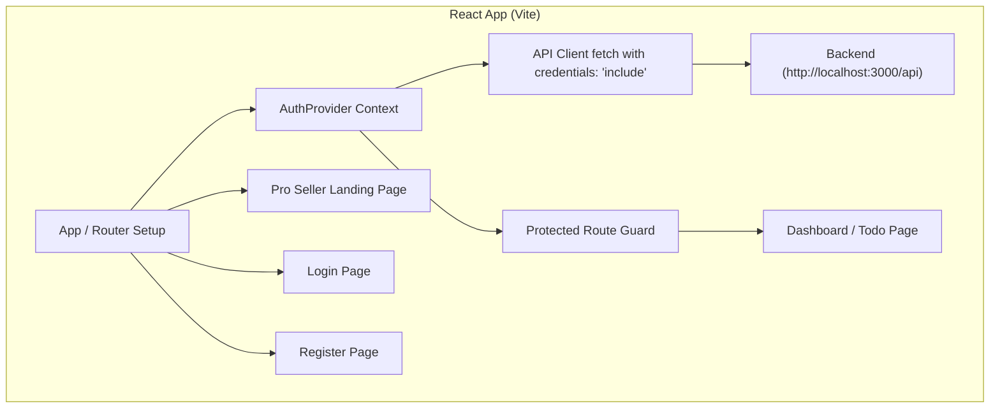

# Auth System & Landing Page Implementation Plan

> **For agentic workers:** REQUIRED SUB-SKILL: Use superpowers:subagent-driven-development to implement this plan task-by-task. Steps use checkbox (`- [ ]`) syntax for tracking.

**Goal:** Implement a complete authentication system with dedicated Login and Register pages, a pro seller landing page, and HTTP cookie-based session management consuming `http://localhost:3000/api`.

**Architecture:** The application uses `react-router-dom` for client routing between `/` (Landing), `/login` (Login), `/register` (Register), and `/dashboard` (Todo Dashboard). An `AuthProvider` wraps the router, providing session state (`user`, `isAuthenticated`, `isLoading`), and on initial mount checks the user's active session via `GET /auth/me` with `credentials: 'include'`. Protected routes redirect unauthenticated users to `/login`.

**Architecture Diagram:**



**Tech Stack:** React 19, TypeScript, React Router DOM, Tailwind CSS.

## Global Constraints
- API Base URL: `http://localhost:3000/api`
- Fetch Config: `credentials: 'include'` on all API requests for HTTP cookie handling
- Router: `react-router-dom` v7+
- Styling: Tailwind CSS v4

---

### Task 1: Dependencies & API Client Updates

**Files:**
- Create/Modify: `package.json`
- Modify: `src/services/api-client.ts`
- Modify: `src/models/User.ts`

**Interfaces:**
- Consumes: None
- Produces: `client` helper methods (`get`, `post`, `put`, `delete`) with `credentials: 'include'` and API endpoint definitions.

- [ ] **Step 1: Install `react-router-dom`**
  Run: `npm install react-router-dom`

- [ ] **Step 2: Update `src/models/User.ts`**
  Ensure standard `User` model interface:
  ```typescript
  export default interface User {
    id: string;
    email: string;
    name?: string;
  }
  ```

- [ ] **Step 3: Update `src/services/api-client.ts`**
  Update `src/services/api-client.ts` so `config` includes `credentials: 'include'`:
  ```typescript
  const config: RequestInit = {
    ...restOptions,
    headers,
    credentials: 'include',
  };
  ```

- [ ] **Step 4: Verify build**
  Run: `npm run build`
  Expected: PASS cleanly

---

### Task 2: Auth Context, `useAuth` Hook, & Route Guards

**Files:**
- Create/Modify: `src/context/authContext.tsx`
- Modify: `src/hooks/useAuth.ts`
- Create: `src/components/ProtectedRoute.tsx`
- Create: `src/components/PublicOnlyRoute.tsx`

**Interfaces:**
- Consumes: `client` from `src/services/api-client.ts`
- Produces: `AuthContext`, `AuthProvider`, `useAuth`, `ProtectedRoute`, `PublicOnlyRoute`

- [ ] **Step 1: Implement `src/context/authContext.tsx`**
  Create `AuthState` interface with `user`, `isAuthenticated`, `isLoading`, `login`, `register`, `logout`. On mount, call `client.get<User>('/auth/me')` inside `useEffect` to restore active cookie session.
  Handle `login(email, password)` via `POST /auth/login`.
  Handle `register(email, password, name)` via `POST /auth/register`.
  Handle `logout()` via `POST /auth/logout`.

- [ ] **Step 2: Implement `src/hooks/useAuth.ts`**
  Export hook returning `useContext(AuthContext)`.

- [ ] **Step 3: Implement `src/components/ProtectedRoute.tsx`**
  Component checking `isAuthenticated` and `isLoading`. If `isLoading`, return spinner. If not authenticated, `<Navigate to="/login" replace />`. Otherwise render `children`.

- [ ] **Step 4: Implement `src/components/PublicOnlyRoute.tsx`**
  Component checking `isAuthenticated`. If authenticated, `<Navigate to="/dashboard" replace />`. Otherwise render `children`.

- [ ] **Step 5: Verify TypeScript build**
  Run: `npm run build`
  Expected: PASS cleanly

---

### Task 3: Pro Seller Landing Page & Nav Components

**Files:**
- Create: `src/pages/Landing.tsx`
- Modify: `src/components/Header.tsx`
- Modify: `src/components/Footer.tsx`

**Interfaces:**
- Consumes: `useAuth` hook, `react-router-dom` `Link`
- Produces: `<Landing />` page, refreshed `<Header />`, refreshed `<Footer />`

- [ ] **Step 1: Update `src/components/Header.tsx`**
  Header with logo ("TaskFlow Pro"), navigation links, and dynamic CTA buttons (Login / Register if unauthenticated, Dashboard / Logout if authenticated).

- [ ] **Step 2: Update `src/components/Footer.tsx`**
  Footer with brand summary, links, and copyright text.

- [ ] **Step 3: Create `src/pages/Landing.tsx`**
  High-converting pro seller landing page:
  - Hero section with bold headline: "Master Your Workflow, Elevate Your Productivity"
  - Interactive feature highlights (Smart Priority Management, Focus Mode, Analytics, Cross-Device Sync)
  - Social proof & statistics counter banner (10k+ active users, 99.9% uptime, 4.9/5 rating)
  - Call to Action (CTA) buttons linking to `/register` and `/login`

- [ ] **Step 4: Verify build**
  Run: `npm run build`
  Expected: PASS cleanly

---

### Task 4: Login & Register Pages

**Files:**
- Modify: `src/pages/Home.tsx` -> rename/refactor into `src/pages/Login.tsx`
- Create: `src/pages/Register.tsx`

**Interfaces:**
- Consumes: `useAuth` hook, `useNavigate`, `Link`
- Produces: `<Login />` and `<Register />` page components

- [ ] **Step 1: Implement `src/pages/Login.tsx`**
  Sleek login form card:
  - Email & Password fields with validation
  - Password show/hide toggle
  - Submit button with loading state
  - Error message dismissible alert
  - Link to `/register`

- [ ] **Step 2: Implement `src/pages/Register.tsx`**
  Registration form card:
  - Name, Email, Password, Confirm Password fields
  - Real-time client validation (passwords match, minimum 6 characters, valid email format)
  - Submit button with loading state
  - Link to `/login`

- [ ] **Step 3: Verify build**
  Run: `npm run build`
  Expected: PASS cleanly

---

### Task 5: Dashboard Refactor, Router Integration & Main App Entry

**Files:**
- Create: `src/pages/Dashboard.tsx`
- Modify: `src/main.tsx`

**Interfaces:**
- Consumes: `BrowserRouter`, `Routes`, `Route`, `AuthProvider`, `<Landing />`, `<Login />`, `<Register />`, `<Dashboard />`
- Produces: Complete working application with client routing and auth protection.

- [ ] **Step 1: Create `src/pages/Dashboard.tsx`**
  Todo application dashboard with header, user welcome banner, task creation form, task filter tabs (All, Active, Completed), task items list, and logout trigger.

- [ ] **Step 2: Update `src/main.tsx`**
  Configure `BrowserRouter` and `Routes`:
  - `/` -> `<Landing />`
  - `/login` -> `<PublicOnlyRoute><Login /></PublicOnlyRoute>`
  - `/register` -> `<PublicOnlyRoute><Register /></PublicOnlyRoute>`
  - `/dashboard` -> `<ProtectedRoute><Dashboard /></ProtectedRoute>`

- [ ] **Step 3: Build & verify**
  Run: `npm run build`
  Expected: Clean build without any errors.
